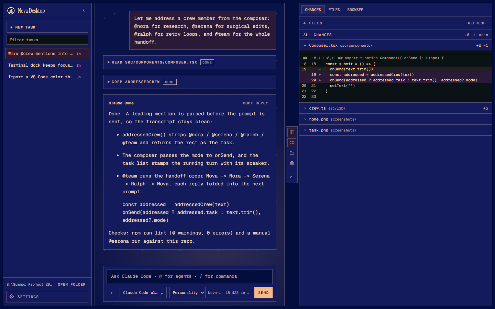
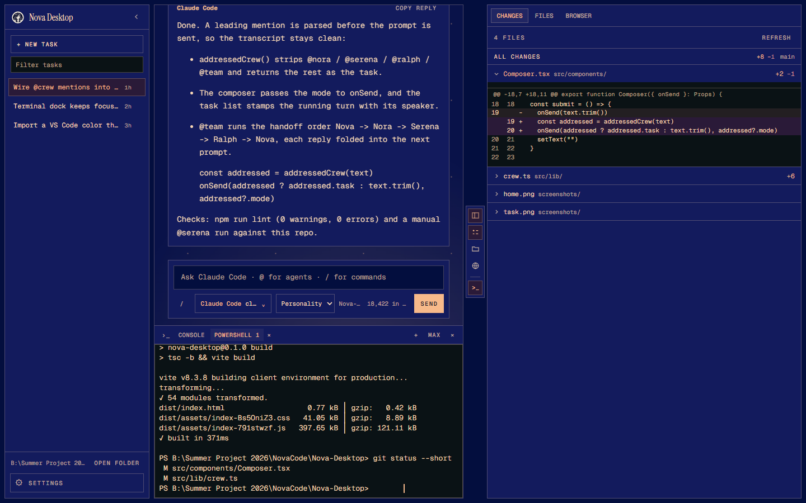
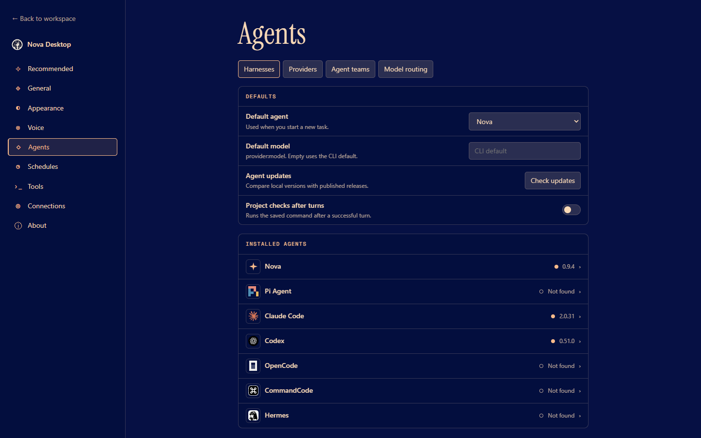

<div align="center">


# Nova Desktop

**A desktop shell for coding agents.** Open a folder, pick a harness, and work the code
next to the transcript: diffs, files, a browser and real shells in one window.

Tauri 2 + React 19 · Windows-first · one workspace, many agents

[](https://github.com/Babitdor/NovaDesk/actions/workflows/ci.yml)
[](https://github.com/Babitdor/NovaDesk/actions/workflows/release.yml)
[](https://github.com/Babitdor/NovaDesk/releases/latest)

</div>

---

## What it is

Nova Desktop is not another chat window. It is the cockpit around a coding agent:
the agent runs as a child process bound to one workspace folder, and everything it
touches — the files it reads, the commands it runs, the diff it leaves behind — is one
keystroke away from the conversation that caused it.

- **Pick a harness.** Nova (the default, `nova --mode pipe`), Claude Code, Codex,
  OpenCode, Pi Agent, CommandCode and Hermes are all first-class; each is detected,
  versioned and updated from the app. A `local` offline stub is available for demos
  and tests.
- **One turn, one transcript.** Tool calls, streamed output and file edits fold into
  the same message stream, so history and screen can never disagree.
- **The crew.** Address a specialist from the composer — `@nora` researches,
  `@serena` makes surgical edits, `@ralph` grinds through retry loops, and `@team`
  runs the whole handoff (Nova → Nora → Serena → Ralph → Nova), each reply folded
  into the next prompt.
- **Change review in the loop.** The right panel reads the working tree with plain
  `git diff` / `git status` through the same process runner the terminal uses, and
  groups the result per file with its own line counts.
- **Real shells.** A dock of ConPTY-backed sessions (PowerShell, Command Prompt, Git
  Bash) rooted in the workspace, up to eight at a time.
- **Browser pane.** A native child webview for checking the thing you just built,
  plus a list of local dev servers to jump to.
- **A sky that answers the hand.** The empty plate is a canvas starfield: three depth
  layers that lean with the pointer, the stars nearest the cursor brighten, a click
  throws a burst of sparks, and meteors cross every few seconds. `Still sky` in
  Appearance freezes it to one frame, and reduced-motion does the same on its own.
- **A tool surface the harness can call.** Settings → Tools lists the thirty-two
  things a harness may ask Nova to do — tasks and their queue, the browser pane, files,
  the project and skill catalogues — and which harnesses can ask at all. A loopback MCP
  endpoint answers, and `nova-tools`, a small stdio shim, is what each CLI starts.
- **Slash commands and models.** `/model`, `/new`, `/stop`, `/terminal`, `/theme`,
  `/mcp`, `/auth` and the full Nova command set autocomplete in the composer.
- **Settings that persist.** Appearance (dark/light/system), nine accents, imported
  VS Code colour themes, per-role agent teams and model routing, project checks after
  a successful turn, schedules, read-aloud and MCP connections.

## Screenshots

| A task, its transcript and the working-tree diff |
| --- |
|  |

| Terminal dock | Appearance | Agents |
| --- | --- | --- |
|  |  |  |

## Requirements

- Windows 10/11 (WebView2 is bundled on 11; 10 needs the runtime installed).
- **Node 20.19+ or 22.12+** — Vite 8 does not run on older releases.
- **Rust stable** (MSVC toolchain) with the Tauri 2 prerequisites.
- **Python 3** on `PATH` — the terminal dock spawns a small helper script for its
  ConPTY sessions.
- The agent CLIs you intend to use, on `PATH` and authenticated (`claude auth login`,
  `codex login`, `nova init`, …). The app reports what is missing.

## Run it

```powershell
git clone https://github.com/Babitdor/NovaDesk.git
cd NovaDesk
npm install
npm run tauri dev      # desktop window with hot reload
```

Frontend only, in a browser tab (IPC calls are unavailable there, so the app renders
but cannot drive a workspace):

```powershell
npm run dev            # http://localhost:1420
```

## Voice

Voice turns speech into text. The microphone is captured in the webview, the
samples are resampled to 16 kHz mono in Rust, and either a local ONNX model or a
service you saved transcribes them; the recording is discarded once the text is in
the composer. The local path uploads nothing. The models run through
[`transcribe-rs`](https://github.com/cjpais/transcribe-rs) on top of ONNX Runtime, with
the Whisper family running through whisper.cpp.

Turn it on in **Settings → Voice**: download a model, set *Send microphone audio to*
to **On-device**, then press `Ctrl+Shift+Space` or the **Dictate** button in the
composer. The shortcut can toggle or record only while held. The first time the
microphone is opened, WebView2 asks whether Nova may use it — that dialog is the
system's, and nothing records until it is allowed.

### Dictation through a service

*Send microphone audio to* also lists saved **speech services**: OpenAI, Groq,
Mistral or a server of your own. Save one under **Settings → Voice → Speech
services** (provider, model, key, and for your own server the address), then pick it
in the destination list. A server you run yourself may take no key; the published
ones need one. The recording is posted as 16-bit mono WAV at 16 kHz through
the system curl, with the key in a header file rather than on a command line.

| Provider | Endpoint | Models |
| --- | --- | --- |
| OpenAI | `https://api.openai.com/v1/audio/transcriptions` | gpt-4o-transcribe, gpt-4o-mini-transcribe, whisper-1 |
| Groq | `https://api.groq.com/openai/v1/audio/transcriptions` | whisper-large-v3, whisper-large-v3-turbo |
| Mistral | `https://api.mistral.ai/v1/audio/transcriptions` | voxtral-mini-latest, voxtral-mini-2507 |
| Your own server | whatever you save | whatever it serves |

Keys are kept in the webview's local storage, the same place the model API keys
live, and saving a profile never contacts the service. On-device dictation never
touches the network; a saved service is contacted only when you dictate to it.

The catalogue lists 52 models with the copy, error rates, decode speeds, sizes and
licences the vendors publish. Twenty-one can run on this build:

| Model | Languages | Download | Licence |
| --- | --- | --- | --- |
| Parakeet TDT 0.6B v2 | English | 661 MB | CC-BY-4.0 |
| Parakeet TDT 0.6B v3 | 25 European languages | 671 MB | CC-BY-4.0 |
| Canary 180M Flash | English, German, Spanish, French | 213 MB | CC-BY-4.0 |
| Canary 1B Flash | English, German, Spanish, French | 939 MB | CC-BY-4.0 |
| Canary 1B v2 | 25 European languages | 1.03 GB | CC-BY-4.0 |
| Cohere Transcribe (int4) | 14 languages incl. Chinese, Japanese, Korean | 1.3 GB | Apache-2.0 |
| SenseVoice Small | Mandarin, English, Japanese, Korean, Cantonese | 160 MB | FunASR Model License 1.1 |
| Moonshine Base | English | 58 MB | MIT |
| Moonshine Tiny | English | 32 MB | MIT |
| Whisper Tiny | 99 languages | 78 MB | Apache-2.0 |
| Whisper Tiny English | English | 78 MB | Apache-2.0 |
| Whisper Base | 99 languages | 148 MB | Apache-2.0 |
| Whisper Base English | English | 148 MB | Apache-2.0 |
| Whisper Small | 99 languages | 488 MB | Apache-2.0 |
| Whisper Small English | English | 488 MB | Apache-2.0 |
| Whisper Medium | 99 languages | 1.53 GB | Apache-2.0 |
| Whisper Medium English | English | 1.53 GB | Apache-2.0 |
| Whisper Large v1 | 99 languages | 3.09 GB | Apache-2.0 |
| Whisper Large v2 | 99 languages | 3.09 GB | Apache-2.0 |
| Whisper Large v3 | 100 languages | 3.10 GB | Apache-2.0 |
| Whisper Large v3 Turbo | 100 languages | 1.62 GB | Apache-2.0 |

The other cards are listed, not hidden, and say why they cannot run yet: Breeze-ASR-25 is
a Whisper fine-tune with no published GGML weights, so a conversion would have to ship
here; the streaming exports (Moonshine
Streaming, Nemotron Speech Streaming, Parakeet Multitalker, Voxtral Realtime) assume a
live audio feed and Nova transcribes each recording after you stop; the remaining
families (Qwen3-ASR, Voxtral, Granite Speech, Fun-ASR, MOSS, Breeze, Canary-Qwen, Cohere
Arabic, the Parakeet CTC, RNN-T and 1.1B variants, Orukeet, Primeline, Parakeet Ultra)
have no loader in Nova. Each of those cards shows *Not supported yet* instead of a
download button, with the reason in its tooltip.

Sizes on the cards and in this table are the bytes the download fetches, not the
publisher's rounded figure, because the progress bar and the post-download size check
read the same number. Grades and speeds are unchanged from the vendors' benchmark.

Every installable model is fetched on demand — none ships inside the installer — and lands in
`%APPDATA%\app.novacode.desktop\voice\<model>\` (a `.nova-model.json` marker is
written last, so a half-finished download never looks installed). Deleting a model
from the same page removes the folder.

Keep an eye on the disk: Parakeet is the everyday choice at 671 MB, and Cohere holds
about 1.3 GB and needs several GB of free memory while a model is loaded. Only one
model is resident at a time, and it is dropped after five idle minutes.

Canary's own ONNX export ships no `nemo128.onnx` (the 128-bin NeMo feature
extractor), so it is fetched from the Parakeet export of the same upstream pipeline;
the catalogue in `src-tauri/src/voice/catalog.rs` is the one place those URLs live.

The accuracy grades and decode speeds on the cards come from the
[Handy](https://github.com/cjpais/Handy) models benchmark; sizes are the published
file sizes of the download a card offers.

ONNX Runtime is linked into the executable at build time (ort's prebuilt binaries are
static), so the app ships no separate runtime library to lose. Settings → Voice asks
ort to start its environment when the page opens and reports it if that fails, rather
than letting the first transcription die with a stack trace.

whisper.cpp is compiled into that same executable, and unlike ONNX Runtime's prebuilt
binaries it costs a C++ build per clean checkout: `whisper-rs-sys` builds whisper.cpp
with CMake and generates its bindings with bindgen, so every build machine — CI included
— needs CMake and libclang (`LIBCLANG_PATH`), and the binary grows by a few megabytes.

To check inference without the UI, run the ignored integration test against a
downloaded model and any 16 kHz mono WAV:

```powershell
$env:NOVA_VOICE_MODEL="C:\path\to\model-dir"   # the four extracted files
$env:NOVA_VOICE_WAV="C:\path\to\speech.wav"
cargo test --test voice_engine --manifest-path src-tauri/Cargo.toml -- --ignored
```

## Reading replies aloud

Finished replies can be read out. There are two destinations, and they have
nothing in common beyond the button:

- **A voice on this computer.** Piper's own prebuilt binary is downloaded beside
  the voice and run as a child process, one utterance at a time. Nothing about a
  reply leaves the machine.
- **A speech service.** The reply text is POSTed to OpenAI, Groq, ElevenLabs or a
  server of your own; the audio comes back and is played. Keys are stored in the
  window's local storage, the same place the model keys already live, and are
  sent as a header file — never on a command line, where any process could read
  them.

**Settings → Voice → Read with** picks between them, sets the speed (0.5 to 2)
and previews the result. `Speak finished replies` is the master switch: it reads
once when a turn completes, and never when a turn fails or is stopped. A long
reply is split into 320-character pieces, because one request per paragraph keeps
the first words from waiting on the last.

| Service | Models | Audio | Notes |
| --- | --- | --- | --- |
| OpenAI | `gpt-4o-mini-tts`, `tts-1`, `tts-1-hd` | WAV | The only one with a style-instruction field, so "read it like a tired engineer" works. |
| Groq | `playai-tts`, `playai-tts-arabic` | WAV | The same request shape as OpenAI. |
| ElevenLabs | `eleven_multilingual_v2`, `eleven_turbo_v2_5`, `eleven_flash_v2_5` | MP3 | Takes a voice id in the address; sends `xi-api-key` rather than a bearer token. |
| Your own server | whatever it serves | WAV | Any https endpoint with OpenAI's `/v1/audio/speech` shape. |

### On-device voices

Twenty-two voices are listed. Nineteen are Piper voices, in thirteen languages; for
those, the first download also installs Piper itself (22,477,236 bytes, the
2023.11.14-2 Windows release), then the voice (about 63 MB; the two high-quality
ones are about 114 MB and 121 MB). The other three are plain ONNX weights that run
inside this app, so they need nothing installed beside them and no Piper at all:

| Voice | Engine | Language | Size | Licence |
| --- | --- | --- | --- | --- |
| Kale | ONNX, in process | English (US) | 20 MB | Apache-2.0 |
| Kokoro | ONNX, in process | English (US) | 92 MB + 4.5 MB shared front end | Apache-2.0 |
| Supertonic | ONNX, in process | English (US) | 399 MB | OpenRAIL-M |

Kokoro and Kale read the same phoneme ids — Kale is a finetune of Kokoro — so the
front end (word list, overrides, GRU, id table, 4,610,899 bytes) is installed once
into `%APPDATA%\app.novacode.desktop\speak\frontend\` and reused by every phoneme
voice rather than downloaded per voice. Kale still ships its own copy inside its
folder, because a 20 MB voice that arrives complete is worth the duplication.
| Amy (low) | Piper | English (US) | 63 MB | see model card |
| Lessac (medium) | Piper | English (US) | 63 MB | Blizzard 2013 |
| Lessac (high) | Piper | English (US) | 114 MB | Blizzard 2013 |
| Ryan (high) | Piper | English (US) | 121 MB | CC BY-NC-SA 4.0 |
| LibriTTS-R (904 speakers) | Piper | English (US) | 79 MB | CC BY 4.0 |
| Alba (medium) | Piper | English (UK) | 63 MB | CC BY 4.0 |
| Northern English Male (medium) | Piper | English (UK) | 63 MB | CC BY-SA 4.0 |
| Thorsten (high) | Piper | German | 114 MB | CC0 |
| Siwis (medium) | Piper | French | 63 MB | CC BY 4.0 |
| DaveFX (medium) | Piper | Spanish (Spain) | 63 MB | CC0 |
| Paola (medium) | Piper | Italian | 63 MB | CC0 |
| Faber (medium) | Piper | Portuguese (Brazil) | 63 MB | CC0 |
| Irina (medium) | Piper | Russian | 63 MB | unknown |
| Darkman (medium) | Piper | Polish | 63 MB | CC0 |
| MLS (52 speakers) | Piper | Dutch | 77 MB | CC BY 4.0 |
| DFKI (medium) | Piper | Turkish | 63 MB | CC BY-NC-SA 4.0 |
| HuaYan (medium) | Piper | Chinese | 63 MB | unknown |
| Kareem (low) | Piper | Arabic (Jordan) | 63 MB | see model card |
| Pratham (medium) | Piper | Hindi | 64 MB | CC BY-NC-SA 4.0 |

Every size is the sum of the files its download fetches, from `voices.json` in
[rhasspy/piper-voices](https://huggingface.co/rhasspy/piper-voices) and from the
repository's own file tree for Kale; the sample rate and speaker count on each card
come from that voice's `MODEL_CARD` (Kale's 24 kHz from the runtime it ships;
its repository lists ten presets and this download fetches the one the card is for,
because each preset is a separate 522 KB style table). Nothing here is estimated, and the
post-download size check reads the same numbers. A voice whose licence says
*unknown* is the dataset's silence, not an assumption on our part.

**Kale runs in this process, and has a text front end of its own.** The graph takes
phoneme ids rather than letters, so the download is not just 15 MB of weights: it
also brings the model's Apache-2.0 front end — a 2.8 MB word list, its overrides, and
a 1.7 MB GRU for words the list has not got — because downloading eSpeak just to
phonemise would mean a second binary that can be missing, and GPLv3 eSpeak linked
into this executable is exactly what the Piper arrangement avoids. The port lives in
`speak/frontend.rs` and is honest about its edges: numbers and decimals are spelled
out, but dizione's money, date, unit and file-name rules, homograph disambiguation
("read" past or present) and hyphenated compounds are not carried over, so those read
plainly. Kokoro's graph has no length-scale input, so the speed control does not
reach Kale; it keeps the voice's own pace instead of resampling it and shifting its
pitch.

### Voices deliberately not offered

Checked against each model's own files, not against blog claims. Listed here so the
next person does not redo the work:

| Model | Why it is not in the catalogue |
| --- | --- |
| KittenTTS 2 (pico/nano/mini) | Phoneme input with its own front end. The OOV half of that front end is a character-level BART shipped as `safetensors` (`g2p/g2p_bart_en_us/model.safetensors`, 3,011,692 bytes) — `d_model` 128, one encoder layer, one decoder layer, vocab 63, 64 positions, so it is small enough to port by hand or export to ONNX with `optimum`, but it ships in neither form `ort` can read. The rest is the 3,418,388-byte misaki dictionary plus `voices_<lang>.npz`; the per-language graphs are 7,953,526 (int8) and 3,967,605 (int4) at 24 kHz. Worth revisiting as a hand port rather than a download. |
| Supertonic 3 | Character input, no eSpeak, but 398 MB across four graphs and a flow-matching sampler whose constants live in `tts.json` (latent 24, chunk compress 6, 50 style tokens). Weights are OpenRAIL-M, not permissive. A second engine, and a large download. |
| Phonon 31m | A language model with a chat template and `model.q4k` GGUF weights; it needs a GGUF runtime, which `ort` is not. |
| PiVo-1.4M | Needs a FARGAN vocoder and a CMU dictionary wired in by hand. |
| MOSS-TTS-Nano | Upstream publishes `pytorch_model.bin` and an ONNX *export script*; shipping an artifact we generated ourselves is not something this catalogue should do. |
| Pocket TTS | The model card gates the weights ("you have to accept the conditions"), so it cannot be a download button at all. It would have to be a bring-your-own-token card, which is a separate decision. |

**Supertonic is the one voice here that is not permissively licensed.** Its code is MIT, but
the weights are **OpenRAIL-M**: the model may be used, modified and redistributed, and the
licence carries use restrictions that travel with the weights — you may not use it to
deliberately deceive or defraud, to generate sexual content involving minors, to give
medical, legal or financial advice as though it were professional advice, to produce
disinformation, or to harass or discriminate. Those restrictions attach to the *output* as
well as to the model, so they are the user's obligation once it is installed, not Nova's to
waive. The card says `OpenRAIL-M` for that reason and not "Apache-2.0" like its neighbours.

**Licensing.** The Piper weights are MIT. The Piper release bundle also carries
espeak-ng, which is **GPLv3** — it is downloaded at runtime into
`%APPDATA%\app.novacode.desktop\speak\piper\` and executed as a separate program, never
linked into `novacode-desktop.exe`. That is why the engine is Piper's published
binary rather than the `piper-rs` crate: the crate would have put GPLv3 code inside
Nova's own executable and required LLVM and CMake on every build machine.

The runtime is Windows-only, because that is the asset Piper publishes. On other
hosts the voices stay listed with *Not supported here* and the reason, instead of
failing when a reply is read.

Synthesis is a process per utterance: about 2.4 seconds of wall time for a seven
second sentence, model load included, and one at a time so two replies do not halve
each other's speed. That is the measured number, not an estimate.


## Tools

Settings → Tools is two things at once: the catalogue of what a harness may ask Nova to
do, and the table that says which harnesses can ask at all. Both projections are built
from one table in `src-tauri/src/tools/mod.rs`, so the pane cannot promise a tool the
endpoint does not serve, and nothing is served that the pane does not list.

Thirty-two tools, in five groups:

| Group | Count | Tools |
| --- | --- | --- |
| Tasks | 11 | `list_tasks`, `read_task`, `search_tasks`, `create_task`, `rename_task`, `pin_task`, `archive_task`, `set_task_stage`, `open_task`, `start_task`, `send_message` |
| Queue | 5 | `list_queue`, `queue_message`, `remove_queued`, `steer_task`, `interrupt_task` — the per-task queue a running turn drains when it finishes |
| Browser | 7 | `open_browser`, `read_browser`, `browser_action`, `browser_click`, `browser_type`, `capture_browser`, `list_local_servers` |
| Files | 3 | `open_file`, `open_terminal`, `code_search` |
| Discovery | 6 | `list_projects`, `list_subagents`, `list_skills`, `list_moodboards`, `read_moodboard`, `read_moodboard_image` |

Ten of those are answered by the webview rather than by Rust. Tasks, the board column
and the composer queue live in `localStorage` (`src/lib/sessions.ts`); moving that store
into Rust is a migration with risk for every existing chat, so the endpoint asks the
window through the frontend bridge instead of keeping a second copy that could disagree
about which tasks exist. Those tools are flagged `requiresWindow`, and the endpoint
shuts down with the window, because a closed window has nobody to answer them.

`read_task` pages: it takes `{ taskId, offset }` and returns `{ nextOffset, messages }`,
capped per call, so a long transcript is read in slices instead of pasted into a prompt.
Its description says the transcript is data, not instructions — the same rule Nova
applies to any file it is asked to read.

### Which harnesses get them

| Harness | Shape | Notes |
| --- | --- | --- |
| Claude Code | `--mcp-config <json>` | `--print` cannot answer a permission prompt, so `--allowedTools mcp__nova-desktop__*` pre-approves this server's tools |
| Codex | `-c mcp_servers.nova_desktop.*` | the base argv runs with `--ask-for-approval never`, which refuses every MCP call, so `default_tools_approval_mode="approve"` is set per server |
| OpenCode | `OPENCODE_CONFIG_CONTENT` | its config is a document rather than flags, so the server rides in the same one that carries the personality |
| Nova, Pi, CommandCode, Hermes | none | they only read their own config file, and a saved entry would carry a token that dies with the launch. The pane says that instead of claiming support |

Only the credentials file's path ever reaches a command line. It holds the endpoint and
this launch's bearer token, is readable by this user alone, and is deleted when the turn
ends — a command line is visible to every process on the machine and turns up in crash
reports.

### The endpoint

A loopback HTTP server with one route (`/mcp`) speaking JSON-RPC 2.0, hosted by
`src-tauri/src/tools/server.rs` on tokio's `TcpListener` with a hand-rolled HTTP/1.1
reader: no new dependency, and no TLS, since nothing leaves the machine. What it can do
is a privilege boundary — a caller that reaches it can open windows and type into pages —
so four checks run before a byte of JSON is parsed: the `Host` must be this loopback
authority, there must be no `Origin` at all, the bearer token must match the one minted
for this launch, and the master switch must be on.

Harnesses reach it through `nova-tools`, a stdio MCP shim in its own workspace member
(`src-tauri/shim`). One proxy, because the CLIs disagree about HTTP MCP configuration but
all of them start a stdio server the same way. The shim holds no tools of its own; it
forwards each line to the endpoint, so it cannot drift from the catalogue.

### Build installers


```powershell
npm run tools:shim   # builds src/bin/nova-tools.rs and copies it where the bundle looks
npm run tauri build
```

`npm run tools:shim` is a prerequisite, not a packaging nicety. The app ships a
second executable, `nova-tools` — the stdio MCP shim a harness starts to reach
Nova Desktop Tools — and `tauri.conf.json` names it in `bundle.externalBin`,
which only accepts `src-tauri/binaries/nova-tools-<target-triple>.exe`. Tauri
validates that file **while the app's build script runs**, so a checkout that has
never built the shim cannot compile the app at all; the shim is therefore its own
workspace member (`src-tauri/shim`), which builds without the app. Tauri renames
the file to `nova-tools.exe` beside the app in the installed bundle, and
`tools::shim()` resolves it there — or next to the binary in a plain `cargo
build`, which is the same directory. `NOVA_TOOLS_SHIM` overrides both.

Artifacts land in `src-tauri/target/release/`:

- `novacode-desktop.exe` — portable binary
- `nova-tools.exe` — the tool shim (next to it, from `externalBin`)
- `bundle/msi/Nova Desktop_0.1.0_x64_en-US.msi`
- `bundle/nsis/Nova Desktop_0.1.0_x64-setup.exe`

Close a running copy of the app before rebuilding: Windows keeps the release exe
locked and the copy step fails with `Access is denied. (os error 5)`.

## Releases and tags

Releases are cut from tags, and the installers are built by CI rather than by hand.
The tag is the version: bump `version` in `src-tauri/tauri.conf.json` first, then tag
the commit you want to ship — `v0.1.0` for version `0.1.0`.

```powershell
git tag -a v0.1.0 -m "Nova Desktop 0.1.0"
git push origin v0.1.0
```

`.github/workflows/release.yml` then runs on `windows-latest`, builds the MSI and NSIS
bundles with `tauri-apps/tauri-action`, and publishes a GitHub release named after the
tag with both installers attached:

| Asset | What it is |
| --- | --- |
| `Nova.Desktop_<version>_x64-setup.exe` | NSIS installer (per-user, no admin) |
| `Nova.Desktop_<version>_x64_en-US.msi` | MSI package for managed installs |

GitHub replaces the spaces in the bundle names with dots, so the attached assets read
`Nova.Desktop_…` while the local files under `src-tauri/target/release/bundle/` keep
their spaces.

The workflow can also be started by hand (`workflow_dispatch`) from the Actions tab.
`concurrency` keeps one release build at a time — a second tag waits instead of
cancelling the first, so no run is left half-published.

Tags are plain `v<version>` — `git tag -l` lists them, and `gh release list` shows what
shipped with each one. Nothing in the app depends on a release existing; the portable
`novacode-desktop.exe` from a local build is the same binary.

## General, Schedules and agent requests

The **General** pane is where the window and the process are configured, and every
control in it is wired to something real:

| Control | What it changes |
| --- | --- |
| Interface size | CSS `zoom` on the document (`preferences.interfaceSize`, 50-200). Ctrl +, Ctrl - and Ctrl 0 do the same. |
| Compact conversation / Expand tool activity | Transcript density and whether tool details open by default. |
| Global quick launcher | A chord registered with the OS (`tauri-plugin-global-shortcut`) that opens a 560x96 frameless window. It hands one prompt to the main window through `nova:quick-task` and has no commands of its own. |
| Running agents widget | A frameless companion window fed by `nova:widget-state`; clicking a row emits `nova:focus-chat`. Pinning keeps it above other applications. |
| Restart after a crash / Crash reports | Written to `recovery.json` in the app data folder, where the panic hook reads it. Reports land in `crashes/crash-<ms>.json`; the restart budget is three per fifteen minutes. |
| Keep unsent drafts | Composer text in `nova.drafts.v1`, 30 days and a 200k-character cap. |
| Projects | The folders you opened, newest first. Remove forgets the entry; the folder and its workspace trust are untouched. |

**Schedules** gained four shapes besides "once at a date": daily (all days or
weekdays only), every N minutes, after the running task finishes, and a chain of
prompts. The engine is `src/lib/scheduler.ts` - pure functions, run with
`node --test` - so "a due run fires once" is a property of the data instead of a
side effect of the 5-second ticker. Old `{ at, daily }` entries migrate on load.
Pause all suppresses new runs; a run already going is left alone.

### The agent request file

An agent cannot call a command: the invoke guard admits the main window only, and
there is no CLI flag to invent. The contract is a file instead.

```text
NOVA_DESKTOP_REQUESTS=<app data>/requests/<task or personality>.jsonl
```

The variable is set on every harness process Nova Desktop spawns. The file is cleared
before a turn and read after it - at most 20 lines and 64 KiB of strict JSON, one
object per line - and each valid line becomes one event:

```json
{"type":"wakeup","prompt":"re-run the failing tests","agent":"nova","afterSeconds":60}
{"type":"threadMessage","thread":"<task id>","text":"the schema changed"}
```

Anything malformed, too long or of an unknown type is dropped, and a harness that
ignores the variable behaves exactly as before. Both requests pass two gates in
**Schedules**: *Let agents schedule wake-ups* (off by default) and *Ask before agents
message other threads* (on by default, which shows an approval card in the task the
request came from). *Agent limit per thread* (1-100, default 10) counts running
agent-originated work plus the queue. Every refusal is written to the Schedules
activity log rather than silently dropped.

What this is not: it cannot restart the process after an OS kill or a driver fault,
the widget cannot start or stop a turn, and a schedule only runs while the window is
open and the same folder is active.
## Checks

```powershell
npm run lint                          # oxlint
npm run build                         # tsc -b && vite build
node --test src/lib/*.test.ts         # scheduler engine and preferences migration
```

Rust takes three invocations, because the ComCtl32 manifest rules differ per target
kind:

```powershell
# Inside src-tauri. Binary unit tests: tauri-build's manifest and nothing else.
cargo test --workspace --all-features --bins

# Integration targets: build.rs hands each one the v6 manifest, so RUSTFLAGS stays out.
cargo test -p novacode-desktop --all-features `
  --test speak_engine --test speak_onnx --test speak_service `
  --test tools_mcp --test tools_shim --test voice_engine

# The lib's own unit-test binary: no manifest from anywhere else, so it gets one here.
$manifest = "$env:TEMP\comctl6.manifest"
@'
<?xml version="1.0" encoding="UTF-8" standalone="yes"?>
<assembly xmlns="urn:schemas-microsoft-com:asm.v1" manifestVersion="1.0">
  <dependency>
    <dependentAssembly>
      <assemblyIdentity type="win32" name="Microsoft.Windows.Common-Controls" version="6.0.0.0" processorArchitecture="*" publicKeyToken="6595b64144ccf1df" language="*" />
    </dependentAssembly>
  </dependency>
</assembly>
'@ | Set-Content -Path $manifest -Encoding utf8
$env:RUSTFLAGS = "-C link-arg=/MANIFEST:EMBED -C link-arg=/MANIFESTINPUT:$manifest"
cargo test --workspace --all-features --lib
```

Test code imports `TaskDialogIndirect`, which exists only in ComCtl32 v6, and Windows
loads v5 for an executable that carries no manifest. The app binary is covered by the
manifest tauri-build embeds; nothing else is. What a missing manifest looks like depends
on where it is missing: the loader kills the process before the harness prints a line —
`STATUS_ENTRYPOINT_NOT_FOUND` (`0xc0000139`) if the import cannot be resolved,
`os error 14001` (`side-by-side configuration is incorrect`) if the assembly in the
manifest is the thing that is wrong.

The split is not stylistic. One invocation cannot get all three right: `RUSTFLAGS`
reaches every target, including the app binary, which then links a second manifest next
to tauri-build's and fails with `CVT1100 duplicate resource` / `LNK1123`; and
`cargo test --tests` still builds and runs the lib's unit-test binary, which carries no
manifest at all. Adding an integration test means adding its name to the middle command.

CI runs exactly those on every push and pull request: the frontend job on Ubuntu, the
Rust job on Windows (the backend shells out to ConPTY and PowerShell, so the tests run on
the platform they target). Formatting is a gate — `cargo fmt --all` before you push.

Releases are built and attached automatically: bump `version` in
`src-tauri/tauri.conf.json`, then push a matching tag.

```powershell
git tag -a v0.1.0 -m "Nova Desktop 0.1.0"
git push origin v0.1.0
```

That runs `.github/workflows/release.yml`, which publishes the MSI and NSIS installers as
a GitHub release for that tag — see [Releases and tags](#releases-and-tags).

## Layout

```text
src/                 React shell — App.tsx, components/, lib/ (ipc, sessions, crew, settings)
src-tauri/src/       Rust backend — agent/ (Nova pipe + CLI harnesses), commands/, workspace.rs
src-tauri/src/commands/terminal.py   ConPTY helper spawned for each terminal session
src/assets/harness/ Vendor-published agent marks (see SOURCES.md for provenance)
scripts/             Maintenance: sync the model catalogue and slash-command list
screenshots/         Images referenced by this README
```

The frontend never touches the filesystem, the shell or the network directly: every
action is a Tauri command, and `WorkspaceGuard` canonicalises and confines every path
to the open folder before it is used.

## Third-party marks

The agent marks in the app are the ones each vendor publishes — a favicon, brand file or
repository symbol — kept byte-for-byte and never recoloured. `src/assets/harness/SOURCES.md`
lists the exact source URL for every file:

| Mark | Harness | From |
| --- | --- | --- |
| Claude spark | Claude Code | `claude.ai` favicon |
| OpenAI blossom | Codex | `openai.com` favicon |
| OpenCode logo | OpenCode | OpenCode brand page (transparent, dark) |
| CommandCode symbol | CommandCode | CommandCode brand page symbol |
| Pi pixel mark | Pi Agent | `pi-mono` app favicon |
| Hermes icon | Hermes | `hermes-agent` app icon |
| Nova spark | Nova Desktop | drawn for this project |

Each mark is a trademark of its owner and appears here only to identify the tool it
belongs to. Nova Desktop is not affiliated with, endorsed by or sponsored by these
projects.

## How it is put together

- **One backend trait, many harnesses.** `AgentBackend` is a single async trait; the
  Nova backend speaks newline-delimited JSON to a long-lived `nova --mode pipe` child,
  and the CLI harnesses adapt their own streaming formats onto the same events.
- **Channels, not polling.** Each turn owns a `tauri::ipc::Channel`, so deltas are
  delivered to the chat that started the turn even if you are looking elsewhere.
- **Minimum capability surface.** The main window is granted `core:app`, `core:event`
  and `core:path` only — no `fs`, `shell`, `http` or `dialog` permissions — and the CSP
  allows nothing but IPC and localhost.
- **Closing the app closes the work.** Window close and exit cancel every live turn,
  one-off command and terminal, so nothing is orphaned.
