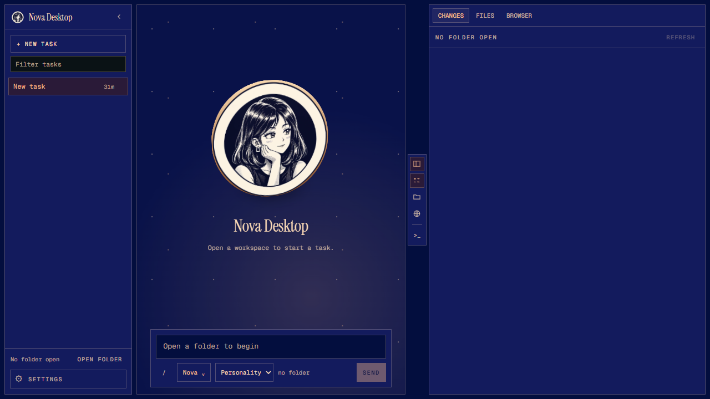
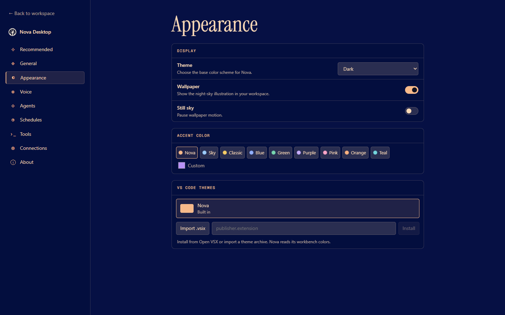

<div align="center">



# Nova Desktop

**A desktop shell for coding agents.** Open a folder, pick a harness, and work the code
next to the transcript: diffs, files, a browser and real shells in one window.

Tauri 2 + React 19 · Windows-first · one workspace, many agents

[](https://github.com/Babitdor/NovaDesk/actions/workflows/ci.yml)
[](https://github.com/Babitdor/NovaDesk/actions/workflows/release.yml)

</div>

---

## What it is

Nova Desktop is not another chat window. It is the cockpit around a coding agent:
the agent runs as a child process bound to one workspace folder, and everything it
touches — the files it reads, the commands it runs, the diff it leaves behind — is one
keystroke away from the conversation that caused it.

- **Pick a harness.** Nova (the default, `nova --mode pipe`), Claude Code, Codex,
  OpenCode, Pi Agent, CommandCode and Hermes are all first-class; each is detected,
  versioned and updated from the app. A `local` offline stub is available for demos
  and tests.
- **One turn, one transcript.** Tool calls, streamed output and file edits fold into
  the same message stream, so history and screen can never disagree.
- **The crew.** Address a specialist from the composer — `@nora` researches,
  `@serena` makes surgical edits, `@ralph` grinds through retry loops, and `@team`
  runs the whole handoff (Nova → Nora → Serena → Ralph → Nova), each reply folded
  into the next prompt.
- **Change review in the loop.** The right panel reads the working tree with plain
  `git diff` / `git status` through the same process runner the terminal uses, and
  groups the result per file with its own line counts.
- **Real shells.** A dock of ConPTY-backed sessions (PowerShell, Command Prompt, Git
  Bash) rooted in the workspace, up to eight at a time.
- **Browser pane.** A native child webview for checking the thing you just built,
  plus a list of local dev servers to jump to.
- **Slash commands and models.** `/model`, `/new`, `/stop`, `/terminal`, `/theme`,
  `/mcp`, `/auth` and the full Nova command set autocomplete in the composer.
- **Settings that persist.** Appearance (dark/light/system), nine accents, imported
  VS Code colour themes, per-role agent teams and model routing, project checks after
  a successful turn, schedules, read-aloud and MCP connections.

## Screenshots

| A task, its transcript and the working-tree diff |
| --- |
|  |

| Terminal dock | Appearance | Agents |
| --- | --- | --- |
|  |  |  |

## Requirements

- Windows 10/11 (WebView2 is bundled on 11; 10 needs the runtime installed).
- **Node 20.19+ or 22.12+** — Vite 8 does not run on older releases.
- **Rust stable** (MSVC toolchain) with the Tauri 2 prerequisites.
- **Python 3** on `PATH` — the terminal dock spawns a small helper script for its
  ConPTY sessions.
- The agent CLIs you intend to use, on `PATH` and authenticated (`claude auth login`,
  `codex login`, `nova init`, …). The app reports what is missing.

## Run it

```powershell
git clone https://github.com/Babitdor/NovaDesk.git
cd NovaDesk
npm install
npm run tauri dev      # desktop window with hot reload
```

Frontend only, in a browser tab (IPC calls are unavailable there, so the app renders
but cannot drive a workspace):

```powershell
npm run dev            # http://localhost:1420
```

## Build installers

```powershell
npm run tauri build
```

Artifacts land in `src-tauri/target/release/`:

- `novacode-desktop.exe` — portable binary
- `bundle/msi/Nova Desktop_0.1.0_x64_en-US.msi`
- `bundle/nsis/Nova Desktop_0.1.0_x64-setup.exe`

Close a running copy of the app before rebuilding: Windows keeps the release exe
locked and the copy step fails with `Access is denied. (os error 5)`.

## Checks

```powershell
npm run lint           # oxlint
npm run build          # tsc -b && vite build
cargo test              # inside src-tauri
```

CI runs exactly those on every push and pull request: the frontend job on Ubuntu, the
Rust job on Windows (the backend shells out to ConPTY and PowerShell, so the tests run on
the platform they target). Formatting is a gate — `cargo fmt --all` before you push.

Releases are built and attached automatically: bump `version` in
`src-tauri/tauri.conf.json`, then push a matching tag.

```powershell
git tag v0.1.0
git push origin v0.1.0
```

That runs `.github/workflows/release.yml`, which publishes the MSI and NSIS installers to
a **draft** GitHub release for you to review and publish.

## Layout

```text
src/                 React shell — App.tsx, components/, lib/ (ipc, sessions, crew, settings)
src-tauri/src/       Rust backend — agent/ (Nova pipe + CLI harnesses), commands/, workspace.rs
src-tauri/src/commands/terminal.py   ConPTY helper spawned for each terminal session
scripts/             Maintenance: sync the model catalogue and slash-command list
screenshots/         Images referenced by this README
```

The frontend never touches the filesystem, the shell or the network directly: every
action is a Tauri command, and `WorkspaceGuard` canonicalises and confines every path
to the open folder before it is used.

## How it is put together

- **One backend trait, many harnesses.** `AgentBackend` is a single async trait; the
  Nova backend speaks newline-delimited JSON to a long-lived `nova --mode pipe` child,
  and the CLI harnesses adapt their own streaming formats onto the same events.
- **Channels, not polling.** Each turn owns a `tauri::ipc::Channel`, so deltas are
  delivered to the chat that started the turn even if you are looking elsewhere.
- **Minimum capability surface.** The main window is granted `core:app`, `core:event`
  and `core:path` only — no `fs`, `shell`, `http` or `dialog` permissions — and the CSP
  allows nothing but IPC and localhost.
- **Closing the app closes the work.** Window close and exit cancel every live turn,
  one-off command and terminal, so nothing is orphaned.
